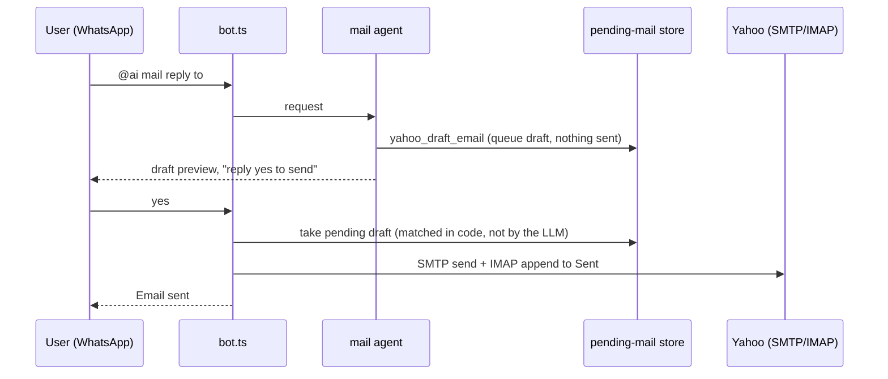

# Yahoo Mail (mail agent)

Read new Yahoo emails and draft/reply to them from WhatsApp. Sending always needs the user's `yes`.

## Setup
1. Yahoo Account > Security > **Generate app password** (the normal password is rejected by IMAP/SMTP).
2. In `.env`: `YAHOO_EMAIL=you@yahoo.com`, `YAHOO_APP_PASSWORD=<app password>` (spaces are ignored).
3. Servers used: IMAP `imap.mail.yahoo.com:993` (SSL), SMTP `smtp.mail.yahoo.com:465` (SSL).

## Usage
- `@ai mail check my new email` — digest of unread mail (nothing is marked read unless asked).
- `@ai mail reply to number 2 saying I agree` — drafts a reply (recipient, `Re:` subject, threading and quote are automatic).
- The default agent also delegates mail requests to the `mail` agent.
- Polling is on demand only; there is no background check.

## Confirmation flow

- One pending draft per chat; a new draft replaces it; drafts expire after 15 minutes and are lost on restart (fails safe).
- `no`/`cancel` discards. Only plain text `yes`/`no`-style replies count; voice notes do not confirm.
- Email bodies are treated as untrusted data by the agent; the send gate does not depend on the LLM.

## Code
`lib/yahoo-mail.ts` (IMAP/SMTP), `lib/pending-mail.ts` (gate), `tools/yahoo-mail.tool.ts` (`yahoo_get_new_emails`, `yahoo_draft_email`), `agents/mail/`, gate in `bot.ts`. The tools are named-agent-only (`named-agents.ts`), so the default agent cannot call them directly.

## Limits
Unread fetch returns the newest 25 (default 10); bodies are truncated to 4000 chars; plain text only, no attachments; full message source is downloaded to parse it.
